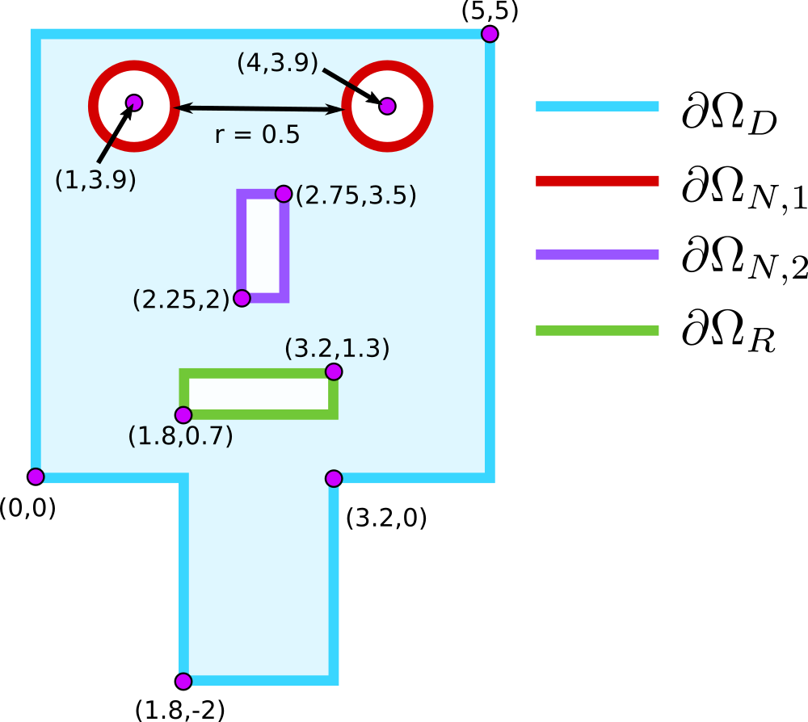

---
jupytext:
  formats: ipynb,md:myst
  text_representation:
    extension: .md
    format_name: myst
    format_version: 0.13
    jupytext_version: 1.19.5
kernelspec:
  display_name: tma4220-finite-elements (3.14.10)
  language: python
  name: python3
---

# Implementation of a finite element solver, part 2: Solving the Poisson problem

+++

The second part of the project will guide you through the implementation of a finite element solver for the Poisson problem in 2D with mixed boundary conditions (i.e. different types of boundary conditions on different parts of the boundary). 

```{code-cell} ipython3
# Make plotted figures interactive
%matplotlib widget

import numpy as np
import matplotlib.pyplot as plt
import scipy.sparse as sp
from scipy.sparse.linalg import spsolve
from numpy.linalg import matrix_rank
import sympy as sy
import meshtools as mt
import plottools as pt
```

## Problem 1 (Weak formulations for Poisson problem with mixed boundary conditions)

+++

The Poisson problem we consider first is given by

\begin{alignat}{3}
-\Delta u &= f && \quad \text{in } \Omega 
\\
u &= g_D  && \quad \text{on } \partial \Omega_D
\\
\nabla u \cdot n &= g_{N,1} && \quad \text{on } \partial \Omega_{N,1}
\\
\nabla u \cdot n &= g_{N,2} && \quad \text{on } \partial \Omega_{N,2}
\\
\nabla u \cdot n &= \kappa(g_R - u) && \quad \text{on } \partial \Omega_R
\end{alignat}

on the following robot face domain:


+++

**a)** Derive a weak formulation of the Poisson problem above with mixed boundary conditions.

You may assume that the boundary of your domain is split up into 4 disjoint parts as above,
 $\partial \Omega = \partial \Omega_D \cup \partial \Omega_{N,1} \cup \partial \Omega_{N,2} \cup \partial \Omega_R$ with $\partial \Omega_D$ having positive measure,
 where each boundary part is a closed $C^1$ polyhedral surface.

**b)**
Prove the well-posedness of the weak formulation using the Lax-Milgram theorem.

**Hint.** You might find it useful to define the following function spaces:

$$
H^1_{g_D,\Gamma_D}(\Omega) = \{ v \in H^1(\Omega) : v = g_D \text{ on } \partial \Omega_D \}
$$

You can assume that this function space is well-defined and a Hilbert space for $g_D = 0$, 
and that the boundary data $g_D$ is such there is a function $u \in H^1(\Omega)$ such that $u = g_D$ on $\partial \Omega_D$
in the trace sense. Also, there is also a Poincaré inequality for functions in $H^1_{0,\Gamma_D}(\Omega)$, i.e. there exists a constant $C_P > 0$ such that 

$$
\| v \|_{L^2(\Omega)} \leq C_P \|
    \nabla v \|_{L^2(\Omega)} \quad \forall v \in H^1_{0,\Gamma_D}(\Omega).
$$.

+++

## Problem 2 (Your first own 2D FEM solver)

+++

The goal of this problem set is to build your first own finite element solver which will probably be a decisive step in your career :)

At the end of this problem we will be able to numerically solve
a simplified version of the Poisson problem from Problem 1, namely
\begin{alignat}{3}
-\Delta u &= f && \quad \text{in } \Omega 
\\
u &= g_D  && \quad \text{on } \partial \Omega_D
\\
\nabla u \cdot n &= g_N && \quad \text{on } \partial \Omega_N
\\
\end{alignat}

Here, $n$ denotes the outward pointing normal vector on $\partial \Omega$.

The implementation will proceed in three steps:

1. Assembly of the stiffness matrix without taking boundary conditions into account.
2. Incorporation of the Dirichlet boundary conditions into the linear system. 
3. Incorporation of Neumann boundary conditions.

+++

## Step 1: Assembly of the stiffness matrix (volume contributions)

+++

**a)** Start by implementing a first version of the  ```assemble_stiffness_matrix(P, C)``` which assemble the volume contributions corresponding to $\int_K \nabla u \cdot \nabla v \, dx$.
Here, $P$ and $C$ are the point and connectivity matrices, respectively.

For simplicity, **we recommend you to use the `dok` matrix format**  discussed in Part 1. Later, as an optional task, you can reimplement it using in the `coo` format, e.g. with the help of an LLM.

Supplement the following code outline.

+++

### Code Outline

First, define a little helper functions which computes
for given triangle $K$ the area $|K|$ and the cofficient vectors $b = (b_0, b_1, b_2)$
and $c = (c_0, c_1, c_2)$. Recall that gradients of the local shape/nodal functions
$\lambda_i$ are given by $\nabla \lambda_i = (b_i, c_i)^T$ for
$i = 0,1,2$.

Before you read through the helper functions convince yourself that the coefficient vectors $b$ and $c$ can be computed as follows:
\begin{align*}
b = (y^{(0)},y^{(1)}, y^{(2)}) \times (1,1,1)
\\
c = (1,1,1)\times (x^{(0)},x^{(1)}, x^{(2)}) 
\end{align*}

```{code-cell} ipython3
def compute_hat_gradients(tri):
    # Compute area (as before)
    # ...
    
    # Compute b and c 
    # You can use np.cross to compute cross products of 3d vectors
    ones = np.ones(3)
    # b = ...
    # c = ...

    # return (area, b, c)
```

**Solution.**

```{code-cell} ipython3
def compute_hat_gradients(tri):
    
    # Compute area (as before)
    N0, N1, N2 = tri
    e1, e2 = N1 - N0, N2 - N0
    area = 0.5 * np.abs((e1[0] * e2[1] - e1[1] * e2[0]))
    
    # Compute b and c 
    # You can use np.cross to compute cross products of 3d vectors
    ones = np.ones(3)
    b = np.cross(tri[:,1], ones)/(2*area)
    c = np.cross(ones, tri[:,0])/(2*area)

    return (area, b, c)
```

Now you are ready to define ```assemble_stiffness_matrix(P, C)```. Follow closely the implementation of the mass matrix assembly with only minor modifications.

+++

**Solution**

```{code-cell} ipython3
def assemble_stiffness_matrix(P, C):
    # Create matrix as before As in the mass matrix assembly:
    # Deduce number of unkowns from dimensions of P
    n_p = P.shape[0]
    # Deduce number of elements from dimensions of T and sparse matrix A
    n_t = C.shape[0]
    # Create sparse matrix A
    A = sp.dok_matrix((n_p, n_p))

    for  T in range(n_t):
        # Get local to global map
        l2g = C[T]
        # Get triangle coordinates and compute area
        tri = P[l2g]
        
        # Compute the area and the coefficient for the hat gradients
        area, b, c = compute_hat_gradients(tri)

        # Numpy Arrays does not behave exactly like n x 1 matrices
        # To compute the outer product b*b.T in Matlab notation
        # we need the np.outer function
        A_K = (np.outer(b, b) + np.outer(c, c))*area
        
        # Add local element matrix to global matrix as before
        A[np.ix_(l2g, l2g)] += A_K

    return A
```

**b**) As a first test run, let us use your new ```assemble_stiffness_matrix``` and the ```assemble_load_vector``` function previously implemented in Part 1.
Assemble the stiffness matrix $A$ and load vector $b$ for 

$$f(x,y) = 1$$

on a simple unit square mesh with resolution $h = 1/N$ and $N = 20$.
Solve the resulting linear system $ AU = b$. 

* Do you get a meaniningful solution? 
* Which kind a boundary problem did you just try to solve? 
* Is this boundary value problem well-posed?
* What is the rank of the matrix?

**Hint**: Look into the first part for recalling how sparse linear systems are solved, don't forget to convert the assembled matrix A into a more efficient format before solving.)

+++

### Code Snippets

```{code-cell} ipython3
# Numpy way to define constant functions such that an
# array of constants is returned if x,y were arrays.
def f(x,y):
    return 1*np.ones_like(x)
```

You can use the following snippet to compute the rank of the matrix A:

```python
# Use scipy to compute the rank of the matrix
A_dense = np.matrix(A.todense())
rank = matrix_rank(A_dense)
``` 

+++

**Solution.**

```{code-cell} ipython3
# %load -s assemble_load_vector projecttools.py
from projecttools import assemble_load_vector, qr_rule_factory

xq, wq = qr_rule_factory("centroid")
print(xq, wq)

def f(x,y):
    return np.ones_like(x)

N = 20
P, C = mt.unitsquare_mesh(N)

A = assemble_stiffness_matrix(P, C).tocsr()
b = assemble_load_vector(f, P, C, xq, wq)
U = spsolve(A, b)

print("N =",N)
X = P[:,0]
Y = P[:,1]
pt.plot2D(X, Y, U, triangles=C)
A_dense = np.matrix(A.todense())
rank = matrix_rank(A_dense)
print ("rank =",rank)
print("Number of unknowns:", len(U))
```

## Step 2: Incorporation of Dirichlet boundary conditions

+++

**c**) Next, we start with implementing the incorporation of Dirichlet boundary conditions.

As a first step, implement a tiny function which checks
whether a given point $x = (x_0, x_1)$ is on the boundary of the unitsquare or not.
The function should return ```True``` if the point is on the boundary, otherwise return ```False```.

```python
def on_dirichlet_boundary(x):
    eps = 1e-12 # Accounts for finite precision
    return  (x[0] < eps) | ...  
```

+++

**Solution.**

```{code-cell} ipython3
# Define a function which checks 
# whether a point x=(x0,x1)is on the boundary of unitsquare
def on_dirichlet_boundary(x):
    eps = 1e-12 # Accounts for finite precision
    return  (x[0] < eps) | (x[1] < eps) | (x[0] > 1-eps) | (x[1] > 1-eps)
```

With such a function a place, one can extract the boundary point using the following code snippet which returns a list of all node indices $i$ of those nodes $N_i$ for which a given function ```inside_domain(N_i)``` evaluates to ```True```.

```{code-cell} ipython3
# Define a function which extract the boundary point 
# and return a list of all node indices i
# def extract_nodes(P, on_boundary):
#     return [ i for i in range(P.shape[0]) if on_boundary(P[i]) ]

def extract_nodes(P, on_boundary):
    return np.flatnonzero(on_boundary(P.T))
```

Now define unitsquare meshes with 1, 2 and 3 subdivision in each direction and 
check whether you extract all Dirichlet boundary nodes correctly by
using the improved `plot_mesh_2d` function now residing in the `plottools` module. Use the new optional 3 function argument "dirichlet_nodes" in `plot_mesh_2d` to plot the extracted nodes.

+++

**Solution.**

```{code-cell} ipython3
# Create unitsquare mesh
for N in range(1,4):
    P, C = mt.unitsquare_mesh(N)
    dirichlet_nodes = extract_nodes(P, on_dirichlet_boundary)
    pt.plot_mesh_2d(P, C, dirichlet_nodes)
```

**d**) Next you need a piece of code to evaluate boundary functions at the nodes you extracted and to incorporate these values into the matrix $A$ and $b$.

+++

Example of evaluation of $g_D$ at Dirichlet nodes

```{code-cell} ipython3
# Generat a mesh
P, T = mt.unitsquare_mesh(5)

# Extract mesh coordinates
X = P[:, 0]
Y = P[:, 1]

# Define/use your on_dirichlet_boundary and extract_nodes functions
# to compute the dirichlet nodes
dirichlet_nodes = extract_nodes(P, on_dirichlet_boundary)

# Extract coordinates associated with Dirichlet nodes 
# using an array slicing operation
X_dc = X[dirichlet_nodes]
Y_dc = Y[dirichlet_nodes]

# Evaluate g at boundary nodes and 
def g_D(x,y):
    return (x+y)              # g_D=x+y
g_D_values = g_D(X_dc, Y_dc)
```

For the incorporation of Dirichlet BC, complete the following code snippet:

```{code-cell} ipython3
def apply_bcs(A, b, dirichlet_nodes, g_D_values):
    # Incorporate boundary condition in vector b
    # by slicing out entries of b associated with dirichlet nodes
    # and setting them to the corresponding value
    # b[...] = ...

    # Incorporate boundary conditions in matrix A
    # 1. Set all rows corresponding to Dirichlet nodes to 0
    #
    #A...
    
    # 2. Set diagonal in Dirichlet nodes to one 
    # (Opposed to Matlab this code line practically
    # extracts a part of the diagonal corresponding to passes indices in  
    # dirichlet_nodes and set them to 1
    #
    # A ...
```

**Solution.**

```{code-cell} ipython3
def apply_bcs(A, b, dirichlet_nodes, g_D_values):
    # Incorporate boundary condition in vector b
    # by slicing out entries of b associated with dirichlet nodes
    # and setting them to the corresponding value
    b[dirichlet_nodes] = g_D_values

    # Incorporate boundary conditions in matrix A
    # 1. Set all rows corresponding to Dirichlet nodes to 0
    A[dirichlet_nodes, :] = 0 
    
    # 2. Set diagonal in Dirichlet nodes to one 
    # (Opposed to Matlab this code line practically
    # extracts a part of the diagonal corresponding to passes indices in  
    # dirichlet_nodes and set them to 1
    A[dirichlet_nodes, dirichlet_nodes] = 1
```

**e**) Next, do a first check of the correctness of your implementation by solving

+++

\begin{alignat*}{3}
-\Delta u &= 0 && \quad \text{in } \Omega \\
 u(x,y) &= x + y &&\quad \text{on } \partial \Omega
\end{alignat*}

+++

and plotting $u$, $u_h$ and their difference. 

What is the exact solution $u$? And how does the finite element solution $u_h$ look like?

**Hint**: Quasi-best approximation property.

```{code-cell} ipython3
def g_D(x,y):
    return (x+y)              # g_D=x+y
def f(x,y):
    return 0*np.ones_like(x)  # f(x,y)=0
def u(x,y):
    return x+y 

for N in [1,5,15]:
    P, C = mt.unitsquare_mesh(N)
    X = P[:,0]
    Y = P[:,1]
    
    dirichlet_nodes = extract_nodes(P, on_dirichlet_boundary)
    X_dc = X[dirichlet_nodes]
    Y_dc = Y[dirichlet_nodes]
    g_D_values = g_D(X_dc, Y_dc)

    A = assemble_stiffness_matrix(P, C)
    b = assemble_load_vector(f, P, C, xq, wq)
    apply_bcs(A, b, dirichlet_nodes, g_D_values)
    A_csr = A.tocsr() 
    U = spsolve(A_csr, b)
    
    print("N =",N)
    pt.plot_comparison_2D(X, Y, u(X,Y), U, triangles=C,
                          title_f1='$u_{\\mathrm{ex}}$', title_f2='$U$')
    print(np.linalg.norm(u(X,Y)-U))
```

**f**) Next, solve the problem
\begin{alignat*}{3}
-\Delta u &= 1 && \quad \text{in } \Omega \\
 u &= 0 &&\quad \text{on } \partial \Omega.
\end{alignat*}
on unit square meshes with mesh size $h=1/N$ for $N = 5, 10, 20, 40$
and plot the FEM solution.

+++

**Solution**. 

```{code-cell} ipython3
def g_D(x,y):
    return 0*np.ones_like(x)              
def f(x,y):
    return 1*np.ones_like(x) 

for N in [5,10,20,40]:
    P, C = mt.unitsquare_mesh(N)
    X = P[:,0]
    Y = P[:,1]
    
    dirichlet_nodes = extract_nodes(P, on_dirichlet_boundary)
    X_dc = X[dirichlet_nodes]
    Y_dc = Y[dirichlet_nodes]
    g_D_values = g_D(X_dc, Y_dc)

    A = assemble_stiffness_matrix(P, C)
    b = assemble_load_vector(f, P, C, xq, wq)
    apply_bcs(A, b, dirichlet_nodes, g_D_values)
    A_csr = A.tocsr() 
    U = spsolve(A_csr, b)
    
    print("N =",N)
    pt.plot2D(X, Y, U, title='U', triangles=C)
```

**g**) Repeat the experiment, this time for the boundary value problem 
\begin{alignat*}{3}
-\Delta u &= 1 && \quad \text{in } \Omega \\
 u &= 0 &&\quad \text{on } \partial \Omega_D,
 \\
 \nabla u \cdot n &= 0 &&\quad \text{on } \partial \Omega_N,
\end{alignat*}
where $\partial \Omega_N = \{1\} \times [0,1]$ is right edge of the the unit square
and $\partial \Omega_D = \partial \Omega \setminus \partial \Omega_N$.

How can you use your current implementation to solve this problem?
How can you interpret the Neuman condition $\nabla u \cdot n = 0$ on $\partial \Omega_N$ geometrically?

+++

**Solution**.

Since we have *homogeneous* Neumann boundary conditions, the only thing
we need to do is to modify the `on_dirichlet_boundary` function to return `False` for the right edge of the unit square.

```{code-cell} ipython3
def on_dirichlet_boundary(x):
    eps = 1e-12 # Accounts for finite precision
    return  (x[0] < eps) | (x[1] < eps) |  (x[1] > 1-eps)

for N in [5,10,20,40]:
    P, C = mt.unitsquare_mesh(N)
    X = P[:,0]
    Y = P[:,1]
    
    dirichlet_nodes = extract_nodes(P, on_dirichlet_boundary)
    X_dc = X[dirichlet_nodes]
    Y_dc = Y[dirichlet_nodes]
    g_D_values = g_D(X_dc, Y_dc)

    A = assemble_stiffness_matrix(P, C)
    b = assemble_load_vector(f, P, C, xq, wq)
    apply_bcs(A, b, dirichlet_nodes, g_D_values)
    A_csr = A.tocsr() 
    U = spsolve(A_csr, b)
    
    print("N =",N)
    pt.plot2D(X, Y, U, title='U', triangles=C)
```

## Step 3: Incorporation of inhomogeneous Neumann boundary conditions

+++

**h**) The next task is to incorporate inhomogeneous Neumann conditions
\begin{align*}
\nabla u \cdot n &= g_N \quad \text{on } \partial \Omega_N
\end{align*}
for some $g_N \neq 0$. Thus to obtain the load vector $b$, you now need to compute integrals of the form   
\begin{align*}
\int_{\Omega} f \varphi_i
\,\mathrm{d}x + \int_{\partial \Omega_N} g_N \varphi_i \quad i = 0,\ldots,n_p-1.
\end{align*}

To do so, you have to do accomplish 2 things:

1. Extract the Neumann boundary edges from the mesh.
2. Modify the load vector assembly to include the Neumann boundary contributions.

+++

**Task 1.**

Similar to extracting the Dirichlet nodes to impose Dirichlet boundary conditions, you need
now to extract the Neumann boundary edges $\mathcal{E}_{h,N}$ of $\mathcal{K}_h$ which comprises the boundary $\partial 
\Omega_N$. At the end of the day you want to have $n_e \times 2$  "Edge" connectivity matrix $\mathcal{E}_N$ 
(similar to the triangle connectivity matrix $C$), where $n_e$ is the number of extracted boundary
edges. Row $j$ in the "Edge" connectivity matrix $E_N$ then gives the the two  indices of the nodes defining the
boundary edge $E_j$. Note that the set of extracted boundary edges is only a *subset* of the set of *all* edges in $\mathcal{T}_h$.

Test the following code to extract the Neumann boundary edges on several meshes
by plotting the meshes via the `plot_mesh_2d` function together with the extracted Neumann boundary points and edges.

```{code-cell} ipython3
def extract_edges(P, T, inside_domain):
    """Short function which extract all edge indices i
    for which the inside_domain(P[i]) evaluates to True
    for both edge vertices.
    """
    edges = []
    for t in T:
        # Iterate over edges
        for i in range(3):
            # Check whether end points of edges are inside domain
            # Note that we use the index notation t[-1] to access the last node
            if inside_domain(P[t[i-1]]) and inside_domain(P[t[i]]):
                edges.append([t[i-1], t[i]])
    # Return the edge list as numpy array to treat it similar
    # to T. Note that we have to explicitly tell the array constructor
    # that the element of the array should be treat as integers!
    # Otherwise you will get indexing problems later one.
    return np.array(edges, dtype=np.int32)
```

**Solution.**

```{code-cell} ipython3
# Define proper 'inside_domain' function 
def inhomog_neumann_boundary(x):
    eps = 1e-12 # Accounts for finite precision
    return  (x[0] < eps) 
# Use 'plot_mesh_2d' function to visually check 'inhomog_neumann_boundary'

for N in range(1,4):
    P, C = mt.unitsquare_mesh(N)
    inhomog_neumann_nodes = extract_nodes(P, inhomog_neumann_boundary)
    inhomog_neumann_edges = extract_edges(P, C, inhomog_neumann_boundary)
    print (inhomog_neumann_nodes)
    print (inhomog_neumann_edges)
    pt.plot_mesh_2d(P, C, inhomog_neumann_nodes, inhomog_neumann_edges)
```

**Task 2.** Next, in addition to the previous arguments ```f, P, C, xq, wq```, you need to pass $E_N$ and $g_N$ to your ```assemble_load_vector``` function and add a loop which assembles the contribution

$$
\int_{E} g_N \varphi_i \,\mathrm{d}S
$$ 

from the boundary $\partial \Omega_N$ by iterating over $\mathcal{E}_{h,N}$. This is **very** similar to
what you did to compute the volume contribution $\int_{K} f \varphi_i \,\mathrm{d}x$.

As we did for the volume contribution, you need to use a quadrature rule to compute the edge integral. You can either pass is as an argument to the function or hardcode it. For simplicity, we recommend you to use the 1-d trapezoidal rule which will be sufficient for our tasks.

Convince yourself that the resulting local/edge load vector contribution looks like
\begin{align*}
b_E = \dfrac{|E|}{2} 
\begin{bmatrix}
g_N(N_0) , g_N(N_1)    
\end{bmatrix}^T
\end{align*}
where $N_0$ and $N_1$ are the two nodes (in local numbering) belonging to edge $E$. 

+++

**Solution.**

```{code-cell} ipython3
# %load -s assemble_load_vector projecttools.py
def assemble_load_vector_with_neumann(f, P, C, xq, wq, g_N, EC_N):
    """Assemble the P1 load vector b_i = int f phi_i dx using quadrature.

    f      : function f(x, y), vectorized over NumPy arrays x and y.
    P      : (N_p, 2) array, coordinates of the mesh vertices (point matrix).
    C      : (N_t, 3) integer array, vertex indices of each triangle (connectivity matrix).
    xq, wq : quadrature points (n_q, 2) and weights (n_q,) on the reference
             triangle, with the weights summing to 1.

    Returns the load vector b as a NumPy array of length N_p.
    """
    # Define constant part here: values of the barycentric coordinates
    # lambda_0 = 1 - x - y, lambda_1 = x, lambda_2 = y at the quadrature points
    Lambda_ref = np.array([1 - xq[:, 0] - xq[:, 1], xq[:, 0], xq[:, 1]])   # (3, n_q)
    # Multiply with the weights: L_ref[alpha, q] = w_q * lambda_alpha(xq_q)
    L_ref = Lambda_ref * wq

    # Deduce number of unknowns from dimensions/shape of P
    n_p = P.shape[0]
    # Deduce number of elements from dimensions of C
    n_t = C.shape[0]
   # Deduce number of edges from dimensions of E_N
    n_e = EC_N.shape[0]
    
    # Create load vector b
    b = np.zeros(n_p)

    for T in range(n_t):
        # Get local to global map from C
        l2g = C[T]
        # Get triangle nodes from P
        tri = P[l2g]
        # Unpack nodes into N0,N1,N2
        N0, N1, N2 = tri
        # Compute area of T
        e1, e2 = N1 - N0, N2 - N0
        area = 0.5 * np.abs((e1[0] * e2[1] - e1[1] * e2[0]))
        # Map the quadrature points to T: row q is sum_beta lambda_beta(xq_q) * N_beta
        xq_T = Lambda_ref.T @ tri                                              # (n_q, 2)
        # Evaluate f at the mapped quadrature points
        f_q = f(xq_T[:, 0], xq_T[:, 1])                                         # (n_q,)
        # Local load vector b_T[alpha] = |T| sum_q w_q lambda_alpha(xq_q) f(F_T(xq_q))
        b_T = area * L_ref @ f_q

        # Add the local contributions to the global load vector
        b[l2g] += b_T
        
    for E in range(n_e):
        # Get local to global map from EC
        l2g = EC_N[E] 
        # Get edge points and compute edge length
        edge = P[l2g]
        edge_len = np.linalg.norm(edge[1]-edge[0])
        # Compute local load vector
        b_E = 0.5*edge_len*g_N(edge[:,0], edge[:,1])
        # Add the local contributions to the global load vector
        b[l2g] += b_E
        
    return b
```

**i**) 
Next, to appreciate your craftsmanship, validate your new functionality using the method
of **manufactured** solutions. Start from the exact solution
$$
u_{ex}(x,y) = \sin(\pi x) \cos(\pi y)
$$
to construct a manufactured solution for the boundary value problem
\begin{alignat*}{3}
-\Delta u &= f && \quad \text{in } \Omega \\
 u &= g_D &&\quad \text{on } \partial \Omega_D,
 \\
 \nabla u \cdot n &= g_N &&\quad \text{on } \partial \Omega_N,
\end{alignat*}
by computing the proper problem data $f$, $g_D$ and $g_N$. Here,
$\Omega = (0,1)^2$ is the unit square,
$\partial \Omega_N = \{0\} \times[0,1]$ is the left edge of the unit
square and
$\partial \Omega_D = \partial \Omega \setminus \partial \Omega_N$.

+++

Proceed as follows:

* With the computed problem data $f$, $g_D$ and $g_N$ at hand, solve the given boundary value problem  numerically using your finite element solver on unit square meshes with mesh size $h=1/N$ for $N = 5, 10, 20, 40$;
* Plot the exact solution $u_{ex}$, the finite element solution $u_h$ and the error function $u_{ex} - u_h$
for $N = 5, 20, 40$;
* For each $N$, record the $L^2$ norm and the $H^1$ semi-norm (see code below) of the error function $u_{ex} - u_h$ and display the error norms against the mesh size $h = 1/N$ both in a log-log plot and in a table. 
For the table plot for each $N$, the mesh size $h$, $L^2$ error, experimental order of convergence (EOC) for $L^2$,  $H^1$ semi-norm error and corresponding EOC.

What convergence rates do you get and why? 

**To get pretty tables**, you can use pandas DataFrames, here is a small example to get you started:

```{code-cell} ipython3
hs = [1/N for N in range(1,6)]
l2_errors = [0.234*2**(-k) for k in range(4)]

print(hs)
print(l2_errors)
conv_table = pd.DataFrame({
    "h": hs,
    "L2_error" : np.concatenate([[np.nan], l2_errors])
}) 
display(conv_table)
```

**Computing the error in the $H^1$ semi-norm.**
The error $u - u_h$ in the $H^1$ semi-norm is given by

$$
|u - u_h|_{H^1(\Omega)}^2 = \int_\Omega |\nabla u - \nabla u_h|^2 \,\mathrm{d}x
= \sum_{K \in \mathcal{T}_h} \int_K |\nabla u - \nabla u_h|^2 \,\mathrm{d}x .
$$

On each element $K$ with vertices $N_0, N_1, N_2$ and global indices $\iota(K, \alpha)$, the discrete solution is $u_h|_K = \sum_{\alpha=0}^{2} U_{\iota(K,\alpha)} \varphi_\alpha$.
The local basis functions $\varphi_\alpha$ are linear, so $\nabla u_h$ is *constant* on $K$:

$$
\nabla u_h|_K = \sum_{\alpha=0}^{2} U_{\iota(K,\alpha)} \nabla \varphi_\alpha
= \begin{pmatrix} \sum_\alpha b_\alpha U_{\iota(K,\alpha)} \\ \sum_\alpha c_\alpha U_{\iota(K,\alpha)} \end{pmatrix},
$$

where $\nabla \varphi_\alpha = (b_\alpha, c_\alpha)$ are exactly the hat function gradients returned by `compute_hat_gradients`.
In the code, this is `grad_uh = np.array([b @ U[l2g], c @ U[l2g]])`.
The exact gradient $\nabla u$ is not constant, so we approximate the element integral with a quadrature rule
$\{\widehat{\boldsymbol{x}}_q, w_q\}_{q=1}^{n_q}$ on the reference triangle (weights summing to 1), mapped to $K$:

$$
\int_K |\nabla u - \nabla u_h|^2 \,\mathrm{d}x \approx |K| \sum_{q=1}^{n_q} w_q \, \bigl|\nabla u(\boldsymbol{x}_q^K) - \nabla u_h|_K\bigr|^2,
\qquad \boldsymbol{x}_q^K = \sum_{\alpha=0}^{2} \lambda_\alpha(\widehat{\boldsymbol{x}}_q) N_\alpha .
$$

In the code, the mapped points are `xq_K = Lambda_ref.T @ tri`, and the sum over $q$ is `area * np.sum(wq * ...)`.
Since $\nabla u - \nabla u_h$ behaves locally like a linear polynomial, its square is essentially quadratic.
We use the six-point rule of degree 4, which integrates this leading part exactly with a safety margin.

+++

Make sure that that you make your `compute_L2_error` from part 1 of the project available.

```{code-cell} ipython3
# Make sure that that you make your compute_L2_error from
from projecttools import compute_L2_error

def six_point_rule():
    """Six-point quadrature rule on the reference triangle, exact for polynomials
    of degree 4. Weights sum to 1."""
    a1, w1 = 0.445948490915965, 0.223381589678011
    a2, w2 = 0.091576213509771, 0.109951743655322
    xq = np.array([[a1, a1], [1 - 2*a1, a1], [a1, 1 - 2*a1],
                   [a2, a2], [1 - 2*a2, a2], [a2, 1 - 2*a2]])
    wq = np.array([w1, w1, w1, w2, w2, w2])
    return xq, wq

def compute_H1_semi_error(grad_u, U, P, T, xq=None, wq=None):
    """Compute the H1 semi-norm error |u - u_h|_{H^1} of a P1 solution using quadrature.

    grad_u : function grad_u(x, y) returning the exact gradient as a tuple
             (du/dx, du/dy), vectorized over NumPy arrays x and y.
    U      : (n_p,) array, nodal values of the P1 solution u_h.
    P, T   : point matrix (n_p, 2) and connectivity matrix (n_t, 3).
    xq, wq : quadrature rule on the reference triangle with weights summing to 1
             (default: six-point rule of degree 4).

    Returns the approximate error |u - u_h|_{H^1(Omega)} as a float.
    """
    if xq is None:
        xq, wq = six_point_rule()
    # Barycentric coordinates at the quadrature points, shape (3, n_q)
    Lambda_ref = np.array([1 - xq[:, 0] - xq[:, 1], xq[:, 0], xq[:, 1]])

    err2 = 0.0
    for K in range(T.shape[0]):
        # Get local to global map and triangle nodes
        l2g = T[K]
        tri = P[l2g]
        # Area and hat function gradients (b_alpha, c_alpha)
        area, b, c = compute_hat_gradients(tri)
        # Gradient of u_h on K (constant)
        grad_uh = np.array([b @ U[l2g], c @ U[l2g]])                  # (2,)
        # Map quadrature points to K and evaluate the exact gradient there
        xq_K = Lambda_ref.T @ tri                                      # (n_q, 2)
        ux, uy = grad_u(xq_K[:, 0], xq_K[:, 1])                        # (n_q,), (n_q,)
        # Quadrature approximation of int_K |grad u - grad u_h|^2 dx
        err2 += area * np.sum(wq * ((ux - grad_uh[0])**2 + (uy - grad_uh[1])**2))

    return np.sqrt(err2)
```

**Solution.**

+++

We define all the rhs function and the domain markers.

```{code-cell} ipython3
def u_ex(x,y):
    return np.sin(np.pi*x)*np.cos(np.pi*y)
def grad_u_ex(x, y):
    return (np.pi*np.cos(np.pi*x)*np.cos(np.pi*y),
            -np.pi*np.sin(np.pi*x)*np.sin(np.pi*y))
    
def f(x,y):
    return 2*np.pi**2*np.sin(np.pi*x)*np.cos(np.pi*y)

def on_dirichlet_boundary(x):
    eps = 1e-12 # Accounts for finite precision
    return  (x[0] > 1-eps) | (x[1] < eps) | (x[1] > 1-eps)
def g_D(x,y):
    return np.sin(np.pi*x)*np.cos(np.pi*y)  
    
def inhomog_neumann_boundary(x):
    eps = 1e-12 # Accounts for finite precision
    return  (x[0] < eps) 
def g_N(x,y):
    return -np.pi*np.cos(np.pi*x)*np.cos(np.pi*y)
```

Now we perform the convergence rate study:

```{code-cell} ipython3
# Convergence study, same setup as in i)
refs = np.array([ 5*2**j for j in range(0,4)])
errors_H1 = np.zeros(refs.size)
errors_L2 = np.zeros(refs.size)
# Quadrature rule for error computation, exact for polynomials of degree 4
xq_err, wq_err = six_point_rule()

for j, N in enumerate(refs):
    P, C = mt.unitsquare_mesh(N)
    X, Y = P[:, 0], P[:, 1]
    E_N = extract_edges(P, C, inhomog_neumann_boundary)
    dirichlet_nodes = extract_nodes(P, on_dirichlet_boundary)
    
    A = assemble_stiffness_matrix(P, C)
    b = assemble_load_vector_with_neumann(f, P, C, xq, wq, g_N, E_N)
    apply_bcs(A, b, dirichlet_nodes, g_D(X[dirichlet_nodes], Y[dirichlet_nodes]))
    
    U = spsolve(A.tocsr(), b)
    
    errors_H1[j] = compute_H1_semi_error(grad_u_ex, U, P, C, xq_err, wq_err)
    errors_L2[j] = compute_L2_error(u_ex, U, P, C, xq_err, wq_err)
    if j in [0,2,3]:
        pt.plot_comparison_2D(X, Y, u_ex(X,Y), U, triangles=C,
                              title_f1='u_ex', title_f2='U')
```

```{code-cell} ipython3
# Plot convergence in H1 semi-norm and L2 norm
eocs_H1 = np.log(errors_H1[:-1] / errors_H1[1:]) / np.log(2)
eoc_L2 = np.log(errors_L2[:-1] / errors_L2[1:]) / np.log(2)
hs = 1.0 / refs
```

```{code-cell} ipython3
import pandas as pd

# Convergence table: the EOC is undefined on the coarsest mesh (NaN, shown as "–")
conv_table = pd.DataFrame({
    "N": refs,
    "h": hs,
    "L2 error": errors_L2,
    "EOC (L2)": np.concatenate([[np.nan], eoc_L2]),
    "H1 error": errors_H1,
    "EOC (H1)": np.concatenate([[np.nan], eocs_H1]),
})
display(conv_table.style
        .format({"h": "{:.4f}", "L2 error": "{:.3e}", "H1 error": "{:.3e}",
                 "EOC (L2)": "{:.2f}", "EOC (H1)": "{:.2f}"}, na_rep="–")
        .hide(axis="index"))

# Log-log plot of the errors against h, with reference slopes h and h^2
fig, ax = plt.subplots()
ax.loglog(hs, errors_L2, "o-", label=r"$\|u - u_h\|_{L^2(\Omega)}$")
ax.loglog(hs, errors_H1, "s-", label=r"$|u - u_h|_{H^1(\Omega)}$")
ax.loglog(hs, errors_L2[0] * (hs / hs[0])**2, "k--", label=r"$\mathcal{O}(h^2)$")
ax.loglog(hs, errors_H1[0] * (hs / hs[0]), "k:", label=r"$\mathcal{O}(h)$")
ax.set_xlabel("$h = 1/N$")
ax.set_ylabel("error")
ax.set_title("Convergence of the P1 solution")
ax.legend()
ax.grid(True, which="both", alpha=0.3)
plt.show()
```

**j)** Finally we want to solve 

\begin{alignat}{3}
- \Delta u &= f && \quad \text{in } \Omega 
\\
u &= g_D  && \quad \text{on } \partial \Omega_D
\\
\nabla u \cdot n &= g_{N,1} && \quad \text{on } \partial \Omega_{N,1}
\\
\nabla u \cdot n &= g_{N,2} && \quad \text{on } \partial \Omega_{N,2} \cup \partial \Omega_{R}
\end{alignat}

posed on our friendly robot face domain given as described the sketch above. The boundary data is given as follows:

Use the following data:

* $g_{N,1} = 0$
* $ f(x,y) = g_D(x,y) = g_{N,2}(x,y) = \cos(2 \pi x/5) \sin(2 \pi y/5)$

and compute the finite element solution for mesh resolution level $10$, $20$, and $40$.

Point and connectivity data sets for triangulation of this domain with different resolutions can
be found in the `project/meshes` folder. You can simply load them via
```python

# Define mesh resolution
ref = 30
# Read in the point matrix
P = np.loadtxt(f"meshes/mesh_points_ref_{ref}.txt")
# Read in the connectivity matrix. Here we must tell the function
# that the elements of the array should be treated as integers.
# Otherwise you will get indexing problems later on.
C = np.loadtxt(f"meshes/mesh_triangles_{ref}.txt", dtype=np.int32) 
```

While this problem looks more complex then the previous ones, don't fear, you code can actually already handle this! It all boils down to define the right boundary functions and to extract the right boundary nodes and edges. 

**Tip.** use the `plot_mesh_2d` tools from `plottools.py` to make sure that you mark the right boundary parts.

+++

**Solution.**

```{code-cell} ipython3
def f(x,y):
    return np.cos(2*np.pi*x/5)*np.sin(2*np.pi*y/5)  

def on_dirichlet_boundary(x):
        eps = 1e-12 
        return  ( ((x[0] > 5-eps) | (x[0] < eps) | ( x[1] > 5-eps))
                  | ( (x[1] < eps) & ((x[0] < 1.8+eps) | (x[0] > 3.2-eps)))
                  |  (x[1] < -2+eps) 
                )

def g_D(x,y):
    return np.cos(2*np.pi*x/5)*np.sin(2*np.pi*y/5)  

def inhomog_neumann_boundary(x):
    eps = 1e-12 # Accounts for finite precision
    return  ( ( (x[0] > 1.8 - eps) 
             & (x[0] < (3.2) + eps) 
             & (x[1] < 1.3 + eps) 
             & (x[1] > 0.7 - eps) )
             | 
             ((x[0] > 2.25 - eps) 
             & (x[0] < (2.75) + eps) 
             & (x[1] < 3.5 + eps) 
             & (x[1] > 2.0 - eps)) 
    )

def g_N_2(x,y):
    return -np.pi*np.cos(np.pi*x)*np.cos(np.pi*y)
```

```{code-cell} ipython3
for ref in [10, 20, 30, 40]:
    P = np.loadtxt("meshes/mesh_points_ref_%d.txt" % ref) 
    C = np.loadtxt("meshes/mesh_triangles_ref_%d.txt" % ref, dtype=np.int32) 
    dirichlet_nodes = extract_nodes(P, on_dirichlet_boundary)
    inhomog_neumann_nodes = extract_nodes(P, inhomog_neumann_boundary) 
    inhomog_neumann_edges = extract_edges(P, C, inhomog_neumann_boundary)
    pt.plot_mesh_2d(P, C, dirichlet_nodes, inhomog_neumann_edges)
    # pt.plot_mesh_2d(P, C, inhomog_neumann_nodes)
```

```{code-cell} ipython3
# Convergence study, same setup as in i)
# Quadrature rule for error computation, exact for polynomials of degree 4
xq_err, wq_err = six_point_rule()

for ref in [10, 20, 30, 40]:
# for ref in [10]:
    P = np.loadtxt("meshes/mesh_points_ref_%d.txt" % ref) 
    C = np.loadtxt("meshes/mesh_triangles_ref_%d.txt" % ref, dtype=np.int32) 
    X = P[:,0]
    Y = P[:,1]
    
    dirichlet_nodes = extract_nodes(P, on_dirichlet_boundary)
    inhomog_neumann_edges = extract_edges(P, C, inhomog_neumann_boundary)

    A = assemble_stiffness_matrix(P, C)
    b = assemble_load_vector_with_neumann(f, P, C, xq, wq, g_N, inhomog_neumann_edges)
    apply_bcs(A, b, dirichlet_nodes, g_D(X[dirichlet_nodes], Y[dirichlet_nodes]))

    U = spsolve(A.tocsr(), b)
     
    pt.plot2D(X, Y, U, triangles=C)
```

## Option problem 3: Vectorized assembly routines using the COO format

+++

If you still enjoying yourself with implementing FEM solver, this task is for you.
As we have seen in part 1 of the project, the assembly of the mass matrix is much much 
faster if we use the **COO** matrix format and vectorized `numpy` operations instead 
of build in Python loops. Corresponding to the `assemble_mass_matrix_coo` function from
part 1, implement a `assemble_stiffness_matrix_coo` and benchmark it against the **DOK** version.

How can we incorporate Dirchlet boundary conditions now, (how) do we need to adapt the `apply_bcs` function? 
You might want to write a coo variant of the `compute_hat_gradients` as well.
You are highly encourage to use a LLM for this task.
In any case, how can you then test that the implementation is correct?

+++

**Vectorized assembly in COO format.**
As for the mass matrix in part 1, we can avoid the Python loop over the elements.
For a triangle with vertices $(x_\alpha, y_\alpha)$, $\alpha = 0, 1, 2$, the hat function gradients are
$\nabla \varphi_\alpha = (b_\alpha, c_\alpha)$ with

$$
b_\alpha = \frac{y_{\alpha+1} - y_{\alpha+2}}{D}, \qquad
c_\alpha = \frac{x_{\alpha+2} - x_{\alpha+1}}{D}, \qquad
D = (x_1 - x_0)(y_2 - y_0) - (x_2 - x_0)(y_1 - y_0),
$$

where the indices are taken modulo 3 and $|K| = |D|/2$.
These are the same formulas as the `np.cross` expressions in `compute_hat_gradients`.
Using the *signed* determinant $D$ makes the gradients correct for both clockwise and counterclockwise vertex ordering.
With the vertex coordinates stored in arrays of shape `(n_t, 3)`, the shifts $\alpha \mapsto \alpha + 1$ and $\alpha \mapsto \alpha + 2$ become the column index lists
`[1, 2, 0]` and `[2, 0, 1]`, so all gradients are computed at once.
The element matrices $A_K = |K| (b b^\top + c c^\top)$ are then assembled exactly as in `assemble_mass_matrix_coo`.

```{code-cell} ipython3
def compute_hat_gradients_vectorized(P, C):
    """Compute the areas and hat function gradients of all triangles at once.

    P : (n_p, 2) array, coordinates of the mesh vertices (point matrix).
    C : (n_t, 3) integer array, vertex indices of each triangle (connectivity matrix).

    Returns (area, b, c), where area has shape (n_t,) and b, c have shape (n_t, 3),
    such that grad phi_alpha = (b[k, alpha], c[k, alpha]) on triangle k.
    """
    # Vertex coordinates of all triangles, shape (n_t, 3)
    x = P[C, 0]
    y = P[C, 1]
    # Signed determinant D = 2 * (signed area), shape (n_t,)
    D = (x[:, 1] - x[:, 0]) * (y[:, 2] - y[:, 0]) - (x[:, 2] - x[:, 0]) * (y[:, 1] - y[:, 0])
    area = 0.5 * np.abs(D)
    # Cyclic shifts of the local index: column alpha of x[:, nxt] holds x_{alpha+1},
    # column alpha of x[:, nxt2] holds x_{alpha+2} (indices modulo 3)
    nxt, nxt2 = [1, 2, 0], [2, 0, 1]
    b = (y[:, nxt] - y[:, nxt2]) / D[:, np.newaxis]
    c = (x[:, nxt2] - x[:, nxt]) / D[:, np.newaxis]
    return area, b, c


def assemble_stiffness_matrix_coo(P, C):
    """Assemble the P1 stiffness matrix A_ij = int grad phi_j . grad phi_i dx in COO format,
    without a loop over the elements.

    P : (n_p, 2) array, coordinates of the mesh vertices (point matrix).
    C : (n_t, 3) integer array, vertex indices of each triangle (connectivity matrix).

    Returns the (n_p, n_p) stiffness matrix as a scipy.sparse.coo_array.
    """
    n_p = P.shape[0]

    # Areas and hat function gradients of all triangles
    area, b, c = compute_hat_gradients_vectorized(P, C)

    # Local stiffness matrices A_K[alpha, beta] = |K| (b_alpha b_beta + c_alpha c_beta)
    A_loc = area[:, np.newaxis, np.newaxis] * (
        b[:, :, np.newaxis] * b[:, np.newaxis, :] + c[:, :, np.newaxis] * c[:, np.newaxis, :])  # (n_t, 3, 3)

    # Rows, cols and values for the COO format, as in assemble_mass_matrix_coo
    rows = np.repeat(C, 3, axis=1).ravel()
    cols = np.tile(C, (1, 3)).ravel()
    vals = A_loc.ravel()

    return sp.coo_array((vals, (rows, cols)), shape=(n_p, n_p))
```

We check that the vectorized version agrees with the loop version.

```{code-cell} ipython3
P, C = mt.unitsquare_mesh(10)
A_loop = assemble_stiffness_matrix(P, C).toarray()
A_vec = assemble_stiffness_matrix_coo(P, C).toarray()
print(f"max |A_loop - A_vec| = {np.abs(A_loop - A_vec).max():.2e}")
```
